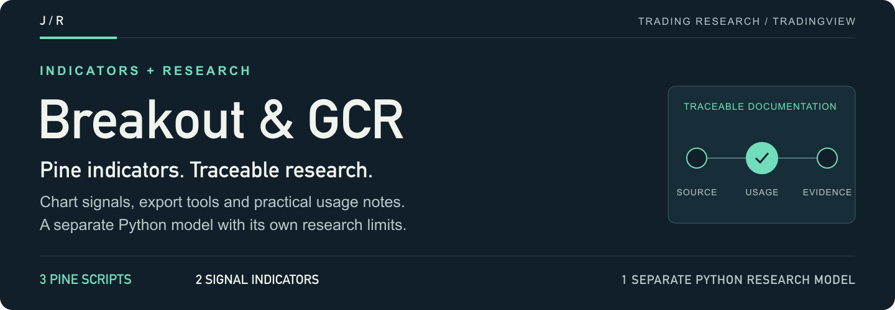
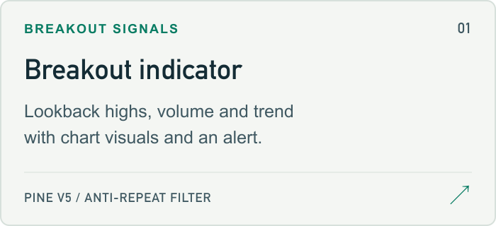
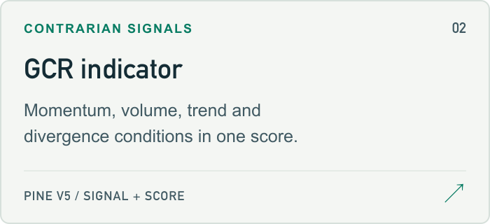
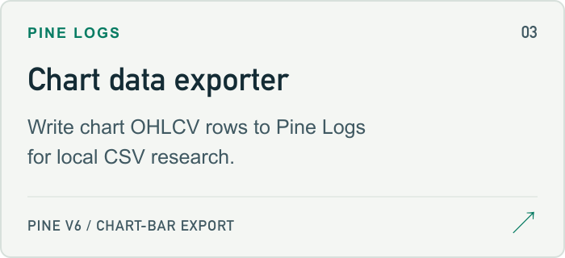

<a href="#usage">
<picture>
  <source media="(max-width: 600px)" srcset="docs/assets/readme/header-mobile.png">
  
</picture>
</a>

  <a href="#pine-indicators"><strong>Pine scripts ↗</strong></a> &nbsp; / &nbsp;
  <a href="#usage">Usage</a> &nbsp; / &nbsp;
  <a href="EXPORT_TV_DATA.md">CSV workflow</a> &nbsp; / &nbsp;
  <a href="https://github.com/jmragsdale/trading-thinkscript">ThinkScript library</a> &nbsp; / &nbsp;
  <a href="https://github.com/jmragsdale">Profile</a>

Pine Script indicators for TradingView, with a separate Python displacement-wick research tool.

**3 Pine scripts · 2 signal indicators · 1 separate Python research model**

Thinkorswim source, scanner queries, installation instructions and standardized historical performance records are maintained in [trading-thinkscript](https://github.com/jmragsdale/trading-thinkscript). This repository maintains the Pine implementations and their research assets.

> **Research boundary:** Saved Python displacement-wick outputs do not validate the breakout or GCR Pine indicators. Current TradingView compilation, replay, alerts, execution and profitability remain untested. Read the [usage notes](#usage) and [historical snapshot limits](research/README.md).

## Explore the repository

Open a card for source, workflow instructions or the retained research record.

<a href="breakout_scanner.pine">
<picture>
  <source media="(prefers-color-scheme: dark)" srcset="docs/assets/readme/breakout-dark.png">
  
</picture>
</a>
<a href="GCR_Strategy_Scanner_TradingView.pine">
<picture>
  <source media="(prefers-color-scheme: dark)" srcset="docs/assets/readme/gcr-dark.png">
  
</picture>
</a>
<a href="data_exporter.pine">
<picture>
  <source media="(prefers-color-scheme: dark)" srcset="docs/assets/readme/exporter-dark.png">
  
</picture>
</a>
<a href="#python-research">
<picture>
  <source media="(prefers-color-scheme: dark)" srcset="docs/assets/readme/python-dark.png">
  
</picture>
</a>
<a href="EXPORT_TV_DATA.md">
<picture>
  <source media="(prefers-color-scheme: dark)" srcset="docs/assets/readme/workflow-dark.png">
  
</picture>
</a>
<a href="research/README.md">
<picture>
  <source media="(prefers-color-scheme: dark)" srcset="docs/assets/readme/snapshots-dark.png">
  
</picture>
</a>

## Pine indicators

| Source | Purpose | Saved version |
| --- | --- | --- |
| [breakout_scanner.pine](breakout_scanner.pine) | Breakout conditions using lookback highs, volume, price change, a long-term moving average and an anti-repeat filter. Includes chart visuals and an alert condition. | Pine v5 |
| [GCR_Strategy_Scanner_TradingView.pine](GCR_Strategy_Scanner_TradingView.pine) | Contrarian signal/score indicator combining momentum extremes, volume, Bollinger Bands, trend and divergence conditions. | Pine v5 |
| [data_exporter.pine](data_exporter.pine) | Writes chart OHLCV rows to Pine Logs for local CSV research. | Pine v6 |

## Usage

1. Open the selected `.pine` source in TradingView's Pine Editor.
2. Attempt compilation on the intended chart and review diagnostics before using the indicator.
3. Review saved inputs, chart timeframe and signal conditions. Configure an alert only after verifying the relevant script and condition.

The breakout defaults are a 126-bar high lookback, 2× average volume, 10% price change and a 200-bar moving average. Inputs operate on chart bars: the price-change expression compares consecutive closes, so a daily label does not make an intraday chart use daily bars. These are indicators with chart signals, not complete order-execution strategies.

The Pine sources were preserved unchanged during the October 29, 2026 repository cleanup. Current TradingView compilation, replay, audible alerts, execution and profitability were not tested. The implementations must not inherit results from another platform or a different research model.

## Python research

[displacement_wick_optimizer.py](displacement_wick_optimizer.py) is a separate Python displacement-wick model and parameter-search utility. It does not backtest the two breakout/GCR indicators above; the matching displacement-wick Pine strategy is not bundled here. Its original source and [setup_optimizer.sh](setup_optimizer.sh) are preserved.

See [EXPORT_TV_DATA.md](EXPORT_TV_DATA.md) for CSV requirements and a local workflow that keeps generated outputs outside the tracked source. The setup script creates `optimizer_env/` and installs its listed dependencies; it was not executed during this cleanup.

The one retained set of historical data/results is documented in [research/README.md](research/README.md). New exports belong in ignored `local-data/`, and optimizer runs should execute from ignored `results/`. Do not overwrite the historical snapshots to record a new run.

## Repository maintenance

The current tree contains no legacy TOS source or duplicated installation guide. The old setup-complete checklist and machine-specific editor permissions were removed. The Pine scripts and Python tool retain their prior source bytes. Historical snapshots were moved, not copied; their hashes are recorded with the research documentation. Git history remains available for prior revisions.

The [README artwork notes](docs/assets/readme/README.md) explain how to regenerate the matching header and cards.

## License

MIT License — as declared by this repository's previous documentation. Existing source comments and attribution remain intact.
